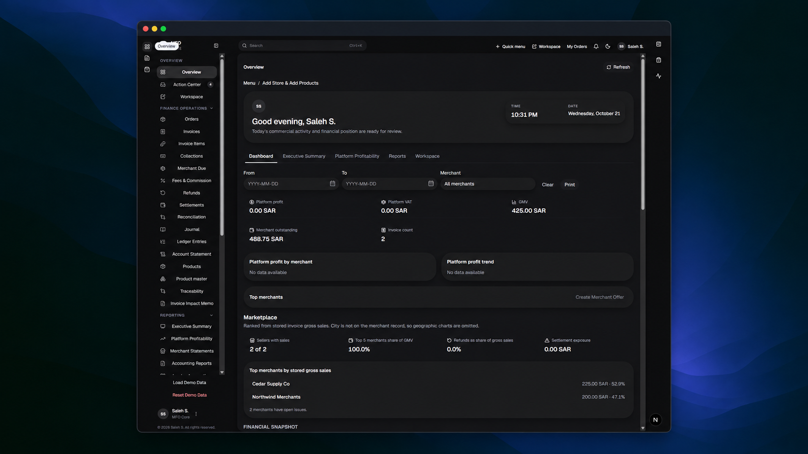
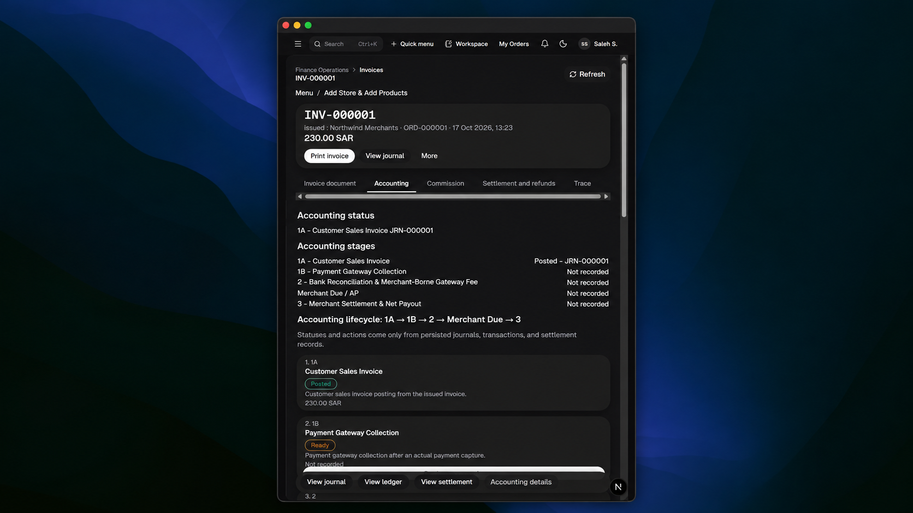
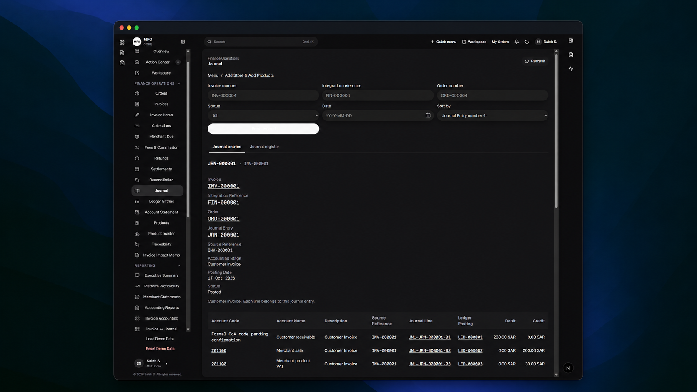
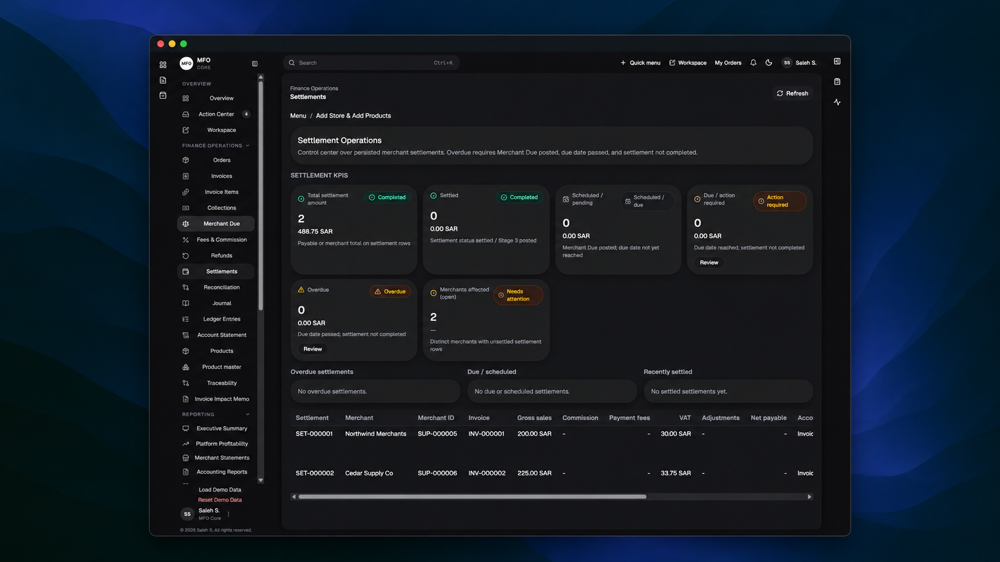
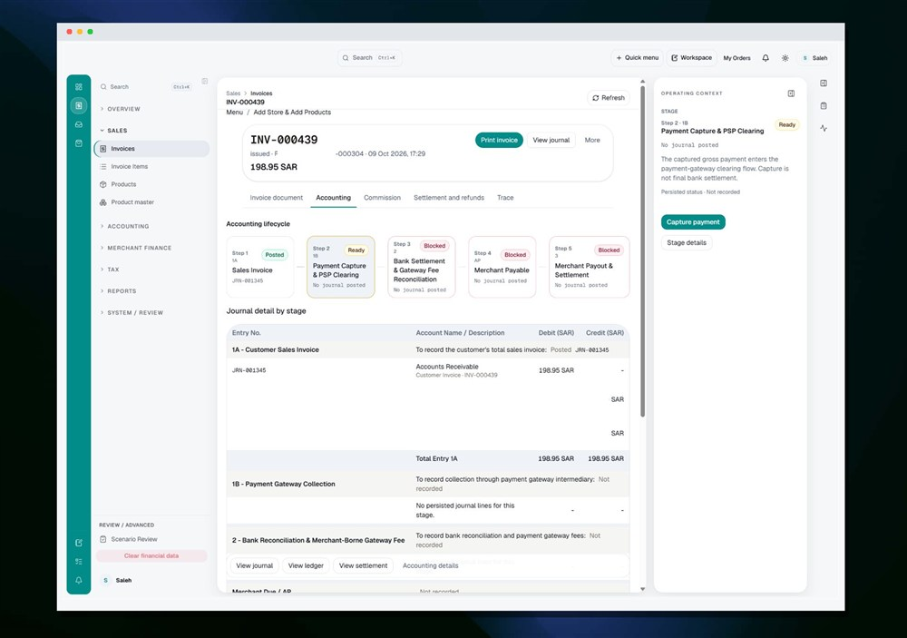
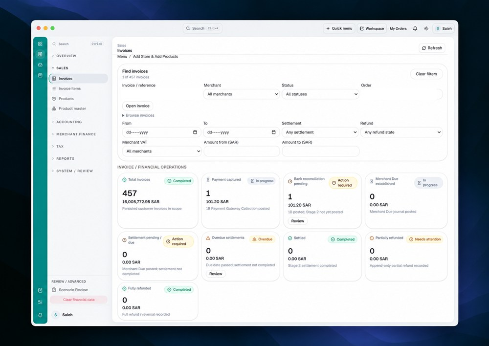

# Marketplace Finance Operations

A finance operations system for managing marketplace transaction states, accounting events, merchant obligations, settlement, reconciliation, and operational review.

## System Overview

The system connects operational transaction records with finance-specific stages and accounting records. It separates transaction progression from journal and ledger records while providing review surfaces for exceptions, settlement readiness, reconciliation, and traceability.

## Transaction Lifecycle

Order → Invoice → Collection → Bank Reconciliation → Merchant Due → Fees / Commission / VAT → Refunds & Reversals → Settlement → Reconciliation & Reporting

The lifecycle is represented through explicit finance stages. Each stage has entry conditions, accounting effects, and review outcomes. See [the lifecycle model](docs/transaction-lifecycle.md).

## Core Finance Capabilities

- Invoice creation and collection tracking
- Merchant due and payable calculation
- Commission, VAT, and gateway-fee handling
- Journal generation and ledger linkage
- Refunds and compensating reversals
- Settlement eligibility and payout status
- Bank reconciliation and exception review
- Operational reporting and traceability

## Architecture

The application layer presents finance operations and review views. The finance workflow layer records stage transitions and accounting events. A relational data layer stores transactional state, finance records, journal lines, settlement records, reconciliation results, and review history.

See [Architecture](docs/architecture.md).

## Controls and Validation

The implementation validates invoice and collection integrity, balanced journal construction, journal-to-ledger linkage, duplicate-event protection, refund limits, settlement eligibility, and reconciliation conditions. See [Controls and Validation](docs/controls-and-validation.md).

## Validation Evidence

The implementation includes validation coverage for:

- balanced journal construction
- journal-to-ledger integrity
- duplicate-event protection
- refund limit validation
- settlement eligibility controls
- reconciliation validation
- lifecycle and accounting scenario coverage

## A Look Inside

| Finance Overview | Invoice Lifecycle |
|---|---|
|  Track finance stages, exceptions, and operational status. |  Follow a transaction from invoice and collection through merchant due. |

| Journal & Ledger | Settlement & Reconciliation |
|---|---|
|  Review balanced accounting records with linked ledger traceability. |  Review settlement readiness, payout state, and reconciliation outcomes. |

## Supplemental Finance Evidence

| Invoice Accounting Progress | Finance Operations Summary |
|---|---|
|  Follow a posted invoice through a ready capture stage with journal detail and operating context. |  Review invoice coverage and finance progression across capture, reconciliation, merchant due, settlement, and refunds. |

## Technology

- TypeScript
- Node.js
- Next.js
- React
- PostgreSQL
- Supabase
- SQLite for local transactional operation
- SQL migrations
- HeroUI
- ECharts

© 2026 Saleh Mukhrish. All rights reserved.

