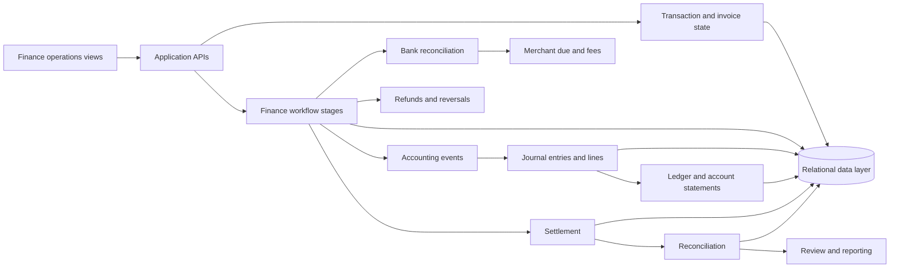

# Architecture

## System boundary

Marketplace Finance Operations is organized around an application layer, a finance operations layer, accounting records, settlement and reconciliation stages, and a relational data foundation. The system boundary covers the finance workflow and its operational review surfaces.

The application layer provides overview, action center, order, invoice, collection, merchant due, fee, refund, settlement, reconciliation, journal, ledger, statement, reporting, and traceability views. The finance operations layer translates operational events into finance stages and accounting events.

## Major components

- **Operational transaction layer** — orders, invoices, invoice items, and collection status.
- **Finance workflow layer** — merchant due, fees and commission, VAT handling, refunds, settlement, and reconciliation.
- **Accounting layer** — journal entries, journal lines, ledger entries, account statements, and invoice impact views.
- **Review layer** — action center, reports, traceability, validation outcomes, and exception-oriented operational views.
- **Data layer** — relational transactional storage, SQL migrations, and a local SQLite runtime with Supabase / PostgreSQL persistence path.
- **Integration boundary** — application APIs and database access used by finance operations and review views.

## Data and control flow

1. An operational transaction reaches an invoice and collection stage.
2. Finance stages calculate merchant due, fees, commission, and VAT effects.
3. Accounting events generate balanced journal records and linked ledger entries.
4. Refunds create controlled compensating effects rather than rewriting prior accounting history.
5. Settlement evaluates eligibility and records payout state.
6. Reconciliation compares the settlement-side movement with the corresponding clearing and bank evidence.
7. Review views expose state, exceptions, and traceability for operational follow-up.

## Journal and ledger model

Accounting events are represented as balanced debit and credit lines. Journal records are linked to ledger records and invoice impacts so an operator can move from a finance stage to its accounting effect and back to the operational context.

The model supports controlled reversals for refunds and preserves accounting history through new compensating events.

## Settlement and reconciliation

Settlement is an explicit finance stage. Eligibility depends on completed preceding stages, merchant due status, refund conditions, and prior settlement state. Reconciliation validates that bank movement and gateway-fee treatment agree with the captured clearing amount, with exceptions routed for review.

## Technology boundary

The implementation uses TypeScript, Node.js, Next.js, React, HeroUI, ECharts, SQL migrations, SQLite for local transactional operation, and Supabase / PostgreSQL integration boundaries.
 
© 2026 Saleh Mukhrish. All rights reserved.
