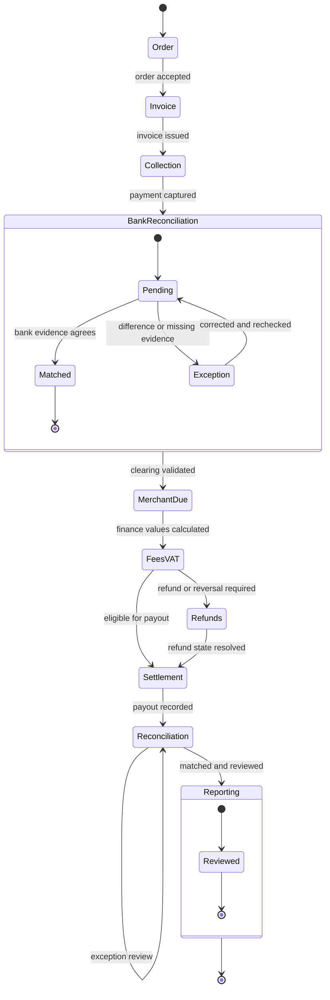
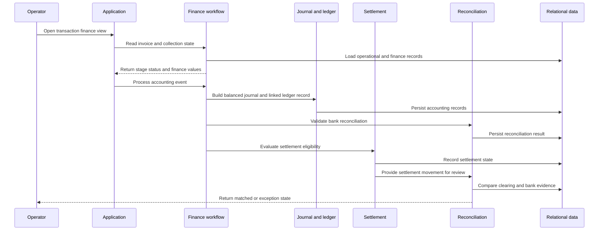

# Transaction Lifecycle

## Lifecycle model

The finance workflow is represented as:

The implementation uses explicit finance stages for customer sales invoice, payment gateway collection, bank reconciliation, merchant-borne gateway fee, and merchant settlement / net payout.

## Order and invoice

The order provides the operational context for the transaction. Invoice creation establishes the finance document and records the invoice-level amounts used by later accounting and settlement steps.

## Collection

Collection records the payment gateway stage. The collection amount is the basis for clearing validation and downstream accounting events.

## Bank reconciliation

Bank reconciliation validates the captured clearing amount against bank movement and gateway-fee treatment before merchant due advances.

## Merchant due

Merchant due represents the amount owed before settlement deductions and payout. It is calculated from the transaction and its finance effects rather than treated as an informal note.

## Fees, commission, and VAT

Commission, VAT, and gateway-fee effects are represented as finance events with explicit mapping into accounting records. Commission rules support configured scope and effective dates; shipping and VAT treatment follow the configured finance model.

## Refunds and reversals

Refunds may be full or partial. A refund cannot exceed the remaining refundable amount. The accounting effect is represented through compensating entries, including a controlled adjustment path when a refund follows settlement.

## Settlement

Settlement is a distinct payout stage. It evaluates whether required stages are complete, merchant due is available, refund conditions are satisfied, and the transaction has not already been settled.

## Reconciliation

Reconciliation compares bank deposit and gateway-fee treatment with the captured clearing amount:

`bank deposit + gateway fee = captured clearing amount`

A mismatch remains an exception for review rather than being silently treated as complete.

## Representative sequence

© 2026 Saleh Mukhrish. All rights reserved.
